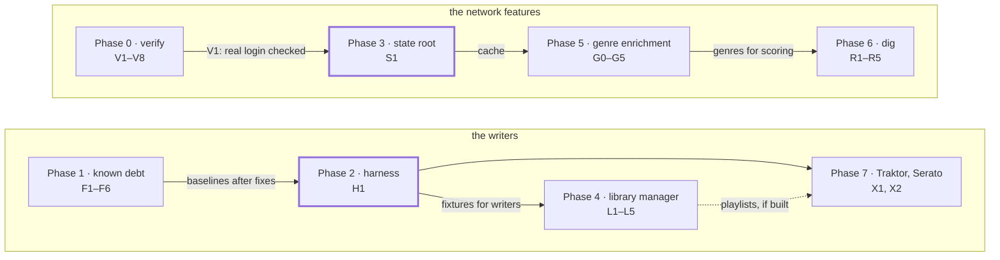

# sdm plan

What comes next for sdm, and in what order: verification first, then
foundations, then the new features. Close the open checks on what is built
(Phase 0), clear the known debt (Phase 1), and build two foundations: a
regression harness (Phase 2) and a place for state that persists between runs
(Phase 3). The five planned features come after that. None of them has been
started.

This is a plan, not a record of state. [README.md](../README.md) says what each
command does today, and [CLAUDE.md](../CLAUDE.md) says how it works. Where this
plan and CLAUDE.md disagree about what exists, CLAUDE.md wins. The plan moved
here from a Claude Doc on 2026-11-13 (see the [log](#log)).

## How this plan works

**Lanes.** Each phase is a lane with its own prefix. Every ticket has a stable
anchor, its id in lowercase (`#f3`), which does not change when its heading
does.

| Prefix | Lane |
| --- | --- |
| V | Phase 0: verification |
| F | Phase 1: known debt (fixes) |
| H | Phase 2: the regression harness |
| S | Phase 3: the state root |
| L | Phase 4: the library manager |
| G | Phase 5: genre enrichment. G0 comes before Phases 5 and 6 |
| R | Phase 6: `dig`, records not yet in the library |
| X | Phase 7: export to Traktor and Serato |
| W | Outside the phases: small changes to the page |
| EO | Ecosystem onboarding |
| D | Open decisions. These are not tickets |

**Needs and order.** *Needs* is a hard need: the ticket cannot start until that
ticket is done, and in the GitHub Project it is a blocked-by link. *After* is
order only, a choice that can change. A phase's needs from
[Sequence and dependencies](#sequence-and-dependencies) apply to every ticket in
it, directly or through a ticket it needs, and the phase's introduction says so.
A ticket that needs an open decision
(D1–D4) stays `backlog` in the Project until the decision is made, because a
decision has no issue to link.

**Done when** is a ticket's acceptance check. Once it holds, the ticket's
heading ends in *done*, and the [log](#log) records what the work found.

**Priority.** The dependency diagram puts the phases in three columns, which
map onto the Project's priorities: Phases 0 and 1 (*now*) are P1, Phases 2 and
3 (*foundations*) are P2, and Phases 4–7 (*features*) are P3. W1 and the
onboarding tickets are P2. A priority set in the Project overrides this.

**Adding work.** A new ticket takes the next number in its lane, and an id is
never reused or renumbered. A split ticket keeps its number and adds a letter
(F6a, F6b). A new lane takes a prefix no lane uses, and the ecosystem's shared
rules say what to check before adding one. **Confidential work never goes in
this file**; the ecosystem's shared rules say where it goes. Every open ticket
has exactly one GitHub issue ([EO7](#eo7)), titled `<id>: <title>`, whose body
links the ticket's anchor and copies nothing from it. A new ticket gets its
issue when it is added.

## Where sdm stands

Checked 2026-11-13, unchanged since 2026-11-03. All seven commands run natively,
in `sdm web`, and in the browser build. The tree has 110 tracked files, version
0.2.0, no test suite and no CI. This is what is still open in each command:

| Command | Status | What is still open | Tickets |
| --- | --- | --- | --- |
| `catalog` | partial | A path typed with forward slashes fails cross-validation. A failed audit still exits 0. The export reads `.mp3` only | [F1](#f1), [F2](#f2). The `.mp3`-only export is deferred ([Phase 1](#deferred-on-purpose)) |
| `duplicates` | done | Nothing. Baseline: 158 groups from 3,664 files in 9m12s | — |
| `rekordbox` | partial | No borrowed fpcalc and no pre-flight. Cannot read `export.pdb`. Artists are blank on a run from the local database alone. `analysis.py` is dead code | [F3](#f3), [F6](#f6), [F4](#f4). Blank artists have no ticket: attaching the USB fills them (CLAUDE.md) |
| `analyze` | done | Cue points and waveforms are skipped on purpose | — |
| `quality` | done | The Rekordbox columns are blank for a USB without the local library behind it, because `export.pdb` is unread | [F6](#f6) |
| `playlist-diff` | done | No saved login in the CLI or `sdm web`. Spotify only serves playlists you own or collaborate on | [S1](#s1). The second is Spotify's rule |
| `playlist-export` | partial | Never run against the real Spotify API with a real client ID | [V1](#v1) |
| `download` | deprecated | Parked. Left alone, not deleted | — |

Of the front ends, `sdm web` is done. Its one planned item, a timeline view of
`analyze`'s phrases, is deferred ([Phase 1](#deferred-on-purpose)). The browser
build runs every command and is live at sdm.eigenomar.com. No command run on the
live site has been checked yet ([V1](#v1)), and the build has never been tested
in Firefox or Safari ([V3](#v3)).

The five planned features are the library manager, Serato/Traktor export,
rbxport integration, genre enrichment and `sdm dig`. They are designed in the
README's [Ideas](../README.md#ideas--not-implemented) section, and none has any
code yet.

## Rules every phase keeps

No phase in this plan relaxes any of these rules. A task that seems to need an
exception is a task to redesign.

- **Features import `sdm.core`, never a sibling.** When two features need the
  same code, it moves to `core` first. `playlist_diff/matching.py` is the next
  candidate, once enrichment or `dig` needs "is this the same track"
  ([G1](#g1)).
- **`add_parser` is argparse only.** A new dependency becomes an extra, imported
  inside the handler, and `sdm --help` keeps working without it.
- **Read-only commands stay read-only.** Each writer gets its own command. It
  backs up `master.db` before writing and refuses to run while Rekordbox has the
  file open.
- **Front ends import no feature.** Behaviour only the browser needs goes through
  a hook in `core`, like `core.tools.runner` and `core.spotify.transport`. No
  feature checks whether it is running in a browser.
- **The browser CSP stays closed.** Today it allows two Spotify hosts and
  nothing else. Adding any origin is a decision recorded in this plan.
- **Every change is checked with a measured run** on the reference clone, and
  each figure states how many tracks it was measured on.

## Phase 0 — Close the verification gaps

The priority is the check no simulation can stand in for: a real Spotify login
([V1](#v1)). The real Cloudflare deploy is done: on 2026-11-09 sdm.eigenomar.com
served the audio tools and the Spotify login, with COOP, COEP and the CSP intact
([V2](#v2)). Beyond that, both front ends were tested only against fakes: a
simulated Spotify API, `wrangler dev`, and headless Edge driven through CDP.
This phase needs no new code unless a check fails.

Each ticket here is done when its check passes, or when its result is written
into the README as a known limit. The phase is done when all of them are. No
ticket in this phase needs another.

### V1 · Real Spotify login with a real client ID

- **Check:** run `playlist-export` and `playlist-diff` from the CLI, from
  `sdm web` and from the browser build. This includes the `/me` 403 for an
  account that is not on the app's user list.
- **Done when:** both commands read a real playlist with a real client ID from
  each of the three front ends, and an account that is not on the app's user
  list gets the `/me` 403 message. Otherwise, the README records the limit.
- **Needs:** nothing.

### V2 · First real deploy to sdm.eigenomar.com · done

- **Check:** `_headers` arrives intact: COOP/COEP, so that cancel by interrupt
  works, and the CSP. The 31 files stay under the 25 MiB per-file limit.
- **Result:** done on 2026-11-09 (CLAUDE.md, *Deployed*). The site answers 200
  with COOP `same-origin`, COEP `require-corp` and the CSP. Its page bundle has
  the Spotify login, and its worker names `fpcalc`, `ffprobe` and `sdm_ffmpeg`.
  The deploy succeeded, so the files fit Cloudflare's limits.

### V3 · Firefox and Safari

- **Check:** the `webkitdirectory` picker, the module worker, and cancel through
  SharedArrayBuffer.
- **Done when:** all three work in both browsers, or the README says where they
  don't.
- **Needs:** nothing.

### V4 · Real pickers

- **Check:** `showDirectoryPicker` on a real folder, a drive root (`D:\`) in
  both pickers, and `master.db` picked through the real Windows file dialog.
- **Done when:** each pick mounts and a command runs on it, or the README
  records the limit.
- **Needs:** nothing.

### V5 · Browser runs at library scale

- **Check:** `rekordbox` with fingerprints over all 3,664 tracks in a tab, and
  `quality` on a file several hours long.
- **Done when:** both finish in a tab, or the README records the limit.
- **Needs:** nothing.

### V6 · The `duplicates` stall in Edge

- **Check:** one run over 3,664 tracks stopped after about 27 minutes of CPU,
  and the rerun finished. Repeat the run 2–3 times. If it stalls again, capture
  the worker's state before closing the tab.
- **Done when:** 2–3 more runs finish, or a stall's worker state is captured and
  the README records the limit.
- **Needs:** nothing.

### V7 · The three cancel paths no test could time

- **Check:** the grace-period fallback, a cancel that lands as a run ends, and a
  cancel sent while the run waits behind another call.
- **Done when:** each of the three ends with no report changed, as the other
  cancel paths do, or the README records the limit.
- **Needs:** nothing.

### V8 · Encoding leftovers

- **Check:** redirect `quality` and `playlist-export` output on a file with a
  name outside cp1252. Do one run on POSIX.
- **Done when:** both redirected runs exit 0 with every report written, and the
  POSIX run's result is recorded. Otherwise, the README records the limit.
- **Needs:** nothing.

## Phase 1 — Known debt in what exists

Five of these are small, local fixes, each with a check that is already known.
The sixth, an `export.pdb` reader, is the one sizeable piece of work. It fills
the last gap shared by `quality` and `rekordbox`. Do the small ones first, in
the order listed. Each ticket's check is its *done when*.

### F1 · Forward-slash paths fail the audit

- **Where:** `features/catalog/`.
- **Change:** normalize the directory argument once, at the start, so the
  sidecar and the re-walk use the same path style. Leave the sidecar's
  `surrogatepass` encoding as it is.
- **Done when:** `sdm catalog "C:/…/postmodern"` and the same path with
  backslashes produce byte-identical CSVs and sidecars, and both report
  `is_valid: True`.
- **Needs:** nothing.

### F2 · A failed audit exits 0

- **Where:** `catalog/exporter.run`.
- **Change:** return a non-zero code when `is_valid` is false, so a script can
  gate on it.
- **Done when:** a tampered sidecar exits non-zero, a clean run exits 0, and an
  `sdm web` job shows the failure.
- **Needs:** [D3](#open-decisions), the exit code. **After:** F1.

### F3 · `rekordbox` needs fpcalc on PATH

- **Where:** `features/rekordbox/command.py`.
- **Change:** wrap detection in `borrowed_fpcalc` and run the pre-flight the way
  `duplicates` does. Keep everything that fingerprints inside the `with` block.
- **Done when:** with no fpcalc installed, the report is byte-identical to a run
  with fpcalc installed, and `tmp/` is empty afterwards.
- **Needs:** nothing. **After:** F2.

### F4 · Dead ANLZ parser

- **Where:** `features/rekordbox/analysis.py`.
- **Change:** delete the file. Nothing imports it, and what it parses is wrong.
- **Done when:** `grep` finds no reference to it, and `--export-csv` output is
  byte-identical.
- **Needs:** nothing. **After:** F3.

### F5 · fpcalc cannot fingerprint a file whose name contains a lone surrogate

- **Where:** `core/fingerprint.py`.
- **Change:** find out first whether the name is lost when fpcalc converts its
  argument. If so, fingerprint the file through a temporary name made of plain
  characters.
- **Done when:** the two fixture files fingerprint, and each matches its copy
  saved under an ordinary name.
- **Needs:** nothing. **After:** F4.

### F6 · `export.pdb` is unread

- **Where:** a new reader in `core`.
- **Change:** a Python reader for the DeviceSQL tables `quality` and
  `rekordbox` need. Check it against rbxport's `rbl-pdb`, built at a pinned
  commit outside this tree. That build is the oracle Phase 4 extends
  ([L1](#l1)).
- **Done when:** its rows equal `rbl-pdb`'s on the reference USB, and a run of
  `quality` on the USB alone, with no local library behind it, fills the `rb_`
  columns. Today that run matches 0 rows, against 3,069 of 3,664 with the local
  library.
- **Needs:** nothing. **After:** F1–F5, the small ones.

### Deferred on purpose

Two items are deferred on purpose. They are not tickets.

- **Non-MP3 files in the `catalog` export.** Adding them would change the
  export, which is the regression baseline. `--missing-metadata` already covers
  every format in `AUDIO_EXTS`.
- **The phrase timeline in `sdm web`.** It is a new view, not debt. Build it
  whenever the work on the page is convenient.

## Phase 2 — A regression harness before the first writer

Before the first writer, write one local script that reruns the baselines in
CLAUDE.md and fails on any difference. Today every baseline is checked by hand.
No verification script is tracked, and the `puppeteer-core` drivers used for
the browser checks are not in the tree. A regression in a reader produces a
wrong report. In the writers of Phases 4 and 7, it produces lost data.

This phase needs Phase 1: the baselines are taken after its fixes.

### H1 · The regression harness

**What it is.** The script runs each command on the reference clone into a
scratch `--out-dir`. It compares the counts and the SHA-256 of every report that
should come out byte-identical against a baseline file in JSON. The baseline can
be tracked even though the reports cannot, because `.gitignore` excludes every
`*.csv` and `*.txt`. The clone's path comes from an environment variable, and
the clone and the fixture playlists stay out of git.

| Tier | Runs | Fails when | Native time (measured) |
| --- | --- | --- | --- |
| Quick | `catalog` with a backslash path, `catalog --missing-metadata`, `analyze`, `rekordbox --export-csv`, `playlist-diff` against the fixture playlist CSVs | A hash changes. The audit is not `is_valid: True`. A count moves off its baseline: 36 tracks missing metadata, 3,655 beat grids, 3,646 tracks with phrases, 76,118 phrases, 0 unknown labels | `catalog` 8.3 s, `--missing-metadata` 5.6 s, `analyze` 49 s warm, all on 3,664–3,665 tracks |
| Slow | `duplicates`, `quality --limit 100` | The count moves off 158 groups, 178 confirmed pairs or 64,157 candidate pairs. The 100-track `quality` CSV is not identical | 9m12s on 3,664 tracks; about 2m15s on 100 tracks at 8 jobs |
| Full | `quality` on the whole clone | The count moves off 484 flagged tracks or off the per-kind counts | 52m20s warm on 3,664 tracks |
| Browser | The `puppeteer-core` driver, committed, against `wrangler dev` | A report differs from native once paths are mapped | `catalog` 21 s, `analyze` 85–88 s, on the reference USB |

**Writer fixtures.** The harness also keeps a scratch copy of `master.db` and
the 12-track set, six duplicate pairs, already used for the browser checks.
Every writer test runs against copies only. A writer that touches the original
in a test is a bug.

- **Done when:** the quick tier passes on the current tree, and fails after a
  threshold in `quality/compare.py` is changed on purpose.
- **Needs:** [F1](#f1)–[F6](#f6).

## Phase 3 — A place for state that persists

Add a third root to `core/paths.py` for state that must outlive a run. Ship the
saved Spotify login on it first. Two things are waiting for this location
already: the CLI and `sdm web` log in on every run, and `dig` and enrichment
cannot work without an HTTP cache. Neither `out/` nor `tmp/` can hold this
state, because `out/` holds reports and `tmp/` is deleted on exit.

This phase needs the real Spotify login checked first ([V1](#v1)).

### S1 · The state root, with the saved Spotify login

**Proposal.** A `state` root, set the way the other two are: `--state-dir`, then
`SDM_STATE_DIR`, then a default. The default is the per-user
`%LOCALAPPDATA%\sdm` rather than `./state`, because a refresh token is a
credential and should not sit in a project folder ([D1](#open-decisions)). It
holds two things:

- **`spotify/`: the login.** It stores the refresh token and renews it 5 minutes
  before expiry, the way the browser build already does. Add a `--logout` option
  or a flag to delete it. Only `core/spotify.py` reads or writes this folder.
- **`cache/<source>/`: HTTP responses for the network features.** Each response
  is stored with the time it was fetched, and each source sets its own expiry.
  This cache is the difference between usable and unusable at MusicBrainz's 1
  request per second. Looking up 3,664 tracks once is about 61 minutes uncached,
  and seconds when cached.

The browser build does not change. Its login stays in localStorage, and nothing
in this phase runs in a tab.

- **Done when:** two `playlist-export` runs in a row open the browser only once,
  and deleting the state folder makes the next run log in again. The README's
  *Saved login* row then moves to done for the CLI and for `sdm web`.
- **Needs:** [V1](#v1), [D1](#open-decisions).

## Phase 4 — Library manager, with rbxport as the oracle

Start the manager as a playlist producer, and hand the writing to Rekordbox or
rbxport. rbxport already edits playlists, tags, cues and beat grids on the same
library, with its own backup and undo, so a writer of sdm's own is worth
building only if handing off fails. This keeps every sdm command read-only for
as long as possible.

Every ticket in this phase needs [H1](#h1), whose writer fixtures it uses,
directly or through a ticket it needs.

### L1 · Extend the oracle from Phase 1

- **Change:** add `rbl-onelibrary` and `rbl-anlz` at the same pinned commit as
  `rbl-pdb` ([F6](#f6)). Diff their output on the reference USB against
  `core/anlz.py`.
- **Done when:** both build at `rbl-pdb`'s pinned commit, and their output on
  the reference USB is diffed against `core/anlz.py`'s, with every difference
  recorded in the [log](#log).
- **Needs:** [F6](#f6), [H1](#h1).

### L2 · Find out what rbxport and Rekordbox import

- **Change:** Rekordbox XML is the likely format, and `rbl-db` has a module for
  it. Record which playlist fields survive the import: order, nesting and names.
- **Done when:** this plan records the format, and whether order, nesting and
  names each survive an import into Rekordbox and into rbxport.
- **Needs:** [H1](#h1). **After:** L1.

### L3 · Produce playlists from reports

- **Change:** a new feature (name to be decided) turns existing reports into
  importable playlists, written to `out/`:
  - one keeper from each `duplicates` group,
  - the owned tracks from `playlist-diff`,
  - the tracks `quality` flagged, by issue kind.
- **Done when:** the feature writes all three kinds of playlist to `out/` in
  the format L2 found, from existing reports, and reads nothing else.
- **Needs:** [L2](#l2), [H1](#h1).

### L4 · Import them into Rekordbox for real

- **Change:** check against a scratch copy of `master.db` from H1's fixtures,
  never the live library. Diff the database before and after with
  `rbl-difftool`.
- **Done when:** L3's playlists are imported into a scratch copy of `master.db`
  from H1's fixtures, and `rbl-difftool`'s diff of that copy, before and after,
  is recorded in the [log](#log).
- **Needs:** [L3](#l3), [H1](#h1).

### L5 · Decide on direct writes

- **Change:** build a writer to `master.db` only if L2–L4 show that importing
  cannot do the job. If one is built, it is its own command. It backs up
  `master.db` first, refuses to run while Rekordbox has the file open, and reads
  through `core/rekordbox_db.py`. Tag edits and moving analysis data in or out
  follow the same rules, and rbxport covers most of what they would do.
- **Done when:** the decision is recorded as D2's outcome. If a writer is built,
  its tests pass on H1's writer fixtures and never touch the original.
- **Needs:** [L2](#l2), [L3](#l3), [L4](#l4), [D2](#open-decisions).

## Phases 5 and 6 — Genre enrichment, then `dig`

Build enrichment first, as a read-only report. `dig` cannot score a result as a
percentile within its genre until the genres of the owned tracks are known. Both
phases need the cache from Phase 3 ([S1](#s1)). Both also need the same shared
code in `core`: source adapters ([G2](#g2)) and the same-track matcher
([G1](#g1)).

### G0 · Before either phase: re-verify the source table

- **Change:** re-verify the README's source table, because access rules move.
  Spotify's February 2026 changes are the precedent: 10 results per search page,
  `popularity` gone for new apps, 5 users per app.
- **Done when:** the README's source table gives each source's current access
  rules and the date they were checked.
- **Needs:** nothing.

### Phase 5 — Genre enrichment

Every ticket in this phase needs [S1](#s1) and [G0](#g0), directly or through
a ticket it needs.

#### G1 · Move the matcher

- **Change:** `playlist_diff/matching.py` moves to `core`, as rule 1 requires.
- **Done when:** `playlist-diff`'s output stays byte-identical on the 3,628-row
  self-playlist.
- **Needs:** [S1](#s1), [G0](#g0).

#### G2 · One adapter interface in `core`

- **Change:** each source reads its key from an environment variable, and the
  command falls back to whichever sources have keys.
- **Done when:** the interface is in `core`, and a command with no keys set runs
  on the sources that need none instead of failing.
- **Needs:** [S1](#s1), [G0](#g0). **After:** G1.

#### G3 · Add the sources in order

- **Change:** MusicBrainz first, for IDs (no key, 1 request per second, a
  User-Agent header required). Then Discogs styles (a token, about 60 requests
  per minute). Then Last.fm tags (an API key).
- **Done when:** each source is an adapter behind G2's interface, keeps to its
  rate limit, and fails on its own without breaking the command.
- **Needs:** [G2](#g2), [S1](#s1), [G0](#g0).

#### G4 · The report

- **Change:** one CSV row per track: path, MusicBrainz IDs, Discogs styles,
  Last.fm tags, and which source and match gave each value.
- **Done when:** the report is written for the reference clone with those
  columns, and the command writes nothing else.
- **Needs:** [G1](#g1), [G3](#g3).

#### G5 · Writing tags back · parked

- **Change:** comes later, as a separate writer command, and only on request.
- **Done when:** the writer is its own command, and its tests pass on H1's
  fixtures without touching an original file.
- **Needs:** [G4](#g4), [H1](#h1), and your request. Parked until then.

### Phase 6 — `dig`

Every ticket in this phase needs [G4](#g4), the genres of the owned tracks,
which brings the cache ([S1](#s1)) and [G0](#g0) with it.

#### R1 · Discogs and the local cross-reference first

- **Change:** seeded by label: "what am I missing from this label". This needs
  one free token, and it is the half no website can do.
- **Done when:** `dig`, seeded by a label, lists that label's releases that the
  library does not own.
- **Needs:** [G4](#g4).

#### R2 · Exclusions

- **Change:** exclude anything already owned (by name, and by fingerprint where
  one exists) and anything rejected before. A file of rejections goes under the
  state root.
- **Done when:** owned and rejected records never appear in `dig`'s results, and
  the rejections persist between runs under the state root.
- **Needs:** [R1](#r1), [G4](#g4), [S1](#s1).

#### R3 · Every result carries why it was returned

- **Change:** each result shows the hops from its seed.
- **Done when:** every row of `dig`'s report lists the hops from its seed.
- **Needs:** [R1](#r1), [G4](#g4).

#### R4 · The underground score

- **Change:** comes last. It is a composite percentile within the seed's genre,
  with each input shown in the report.
- **Done when:** every result carries the score and each input to it.
- **Needs:** [G4](#g4). **After:** R1–R3.

#### R5 · `dig` in the browser build · parked

- **Change:** not at first. `dig` would add at least three origins to
  `connect-src`, and whether those APIs allow CORS is unchecked.
- **Done when:** each source `dig` uses in a tab is checked for CORS, and the
  origins it adds are recorded in this plan as the CSP rule asks.
- **Needs:** [G4](#g4), [D4](#open-decisions). **After:** R1–R4.

## Phase 7 — Serato and Traktor export

Export to Traktor before Serato, because Traktor's export writes no audio file.
Traktor keeps the whole collection in one XML file, `collection.nml`. Serato
stores its analysis in `GEOB` frames inside each audio file. Nothing in sdm
modifies an audio file today, so writing those frames is new ground and comes
second. rbxport does not help here, since none of its crates targets either
format.

- **Shape:** a one-way export, as its own command, written to a destination USB
  and never to the source library. Every run ends with a report of what did not
  carry over. Phrase structure never does.
- **Inputs:** sdm's readers (`core/anlz.py` for beat grids, the database for
  BPM and key). The library manager's playlists, if Phase 4 has built them by
  then ([L3](#l3)). That is an input, not a need.
- **Check:** load the result in Traktor and in Serato. A file that parses
  correctly does not prove a player accepts it, as rbxport's own README warns.

Every ticket in this phase needs [H1](#h1).

### X1 · Export to Traktor

- **Change:** the export above, writing `collection.nml` to the destination.
- **Done when:** the result loads in Traktor, and the run's report lists what
  did not carry over.
- **Needs:** [H1](#h1).

### X2 · Export to Serato

- **Change:** it copies files to the destination before writing `GEOB` frames,
  and never touches the originals. Its own regression check confirms each
  copy's audio stream is byte-identical apart from the tags.
- **Done when:** the result loads in Serato, the regression check passes, and
  the originals are unchanged.
- **Needs:** [H1](#h1). **After:** X1.

## Outside the phases

One small change needs none of the phases, so it can land at any time.

### W1 · A button back to eigenomar.com

- **Change:** sdm has no footer, so the button goes at the foot of the sidebar,
  in the browser branch of `.sidebar-foot` in `frontend/src/App.tsx`. Make it a
  link to `https://eigenomar.com`, labelled `eigenomar.com`, with the `.button`
  styles. Open it in a new tab (`target="_blank" rel="noreferrer"`, as the app's
  other outside links do), because reports live in the tab and leaving would
  lose them. A link adds no origin, so the browser CSP stays closed.
- **Done when:** the button shows on sdm.eigenomar.com, works by keyboard, and
  opens eigenomar.com in a new tab while jobs and reports stay in place.
- **Needs:** nothing.

## Sequence and dependencies

The harness gates the writers, and the state root gates the network features.
An arrow runs from a prerequisite to the phase that needs it. The two
foundations are drawn thicker.

The top row leads to the writers and the bottom row to the network features.
The two tracks are independent, so they can be worked in parallel, and there is
no arrow between them. No phase has a date yet. The gates in the decisions
table below sit inside the phases, not between the boxes. W1 is outside both
tracks.

## Open decisions

These are yours to make. Each one blocks only the tickets in its row. When one
is made, its outcome and date go in its row, and the [log](#log) records it.

| Id | Decision | Options | Recommendation | Blocks |
| --- | --- | --- | --- | --- |
| D1 | Where persistent state lives | `%LOCALAPPDATA%\sdm`, or `./state` in the project | The per-user folder, which `SDM_STATE_DIR` can override | [S1](#s1), and through it Phases 5 and 6 |
| D2 | Who writes playlists | sdm writes `master.db` itself, or hands off through Rekordbox XML or rbxport | Hand off first | [L5](#l5) |
| D3 | `catalog`'s exit code for a failed audit | Any non-zero code | One that is not 2, since `--missing-metadata` already uses 2 for a path that is not a directory | [F2](#f2) |
| D4 | `dig` in the browser build | Never, or later | Later, and only once the sources are known to allow CORS | [R5](#r5) |

### Risks

- **The third-party APIs change.** Spotify, Discogs and Last.fm have each
  changed their access rules before. Each adapter must fail on its own, without
  breaking the command ([G3](#g3)).
- **A bug in a writer loses library data.** Four things guard against it: each
  writer is its own command, it backs up first, it refuses to run while
  Rekordbox has the file open, and its tests run on fixtures only ([H1](#h1)).
- **The browser `duplicates` stall has no known cause** ([V6](#v6)).
- **There is no CI.** The harness catches only what someone remembers to run.

## Ecosystem onboarding

sdm is one of the eigenomar ecosystem's repositories, coordinated through a
shared contract: a `project.yaml` manifest, shared Claude rules imported by
`CLAUDE.md`, and one issue per open ticket on the ecosystem's GitHub Project.

**Goal.** Make sdm discoverable and coordinated in the ecosystem without
changing how it is built or delivered.

**Stays as it is.**

- **Build:** `pip install -e ".[all]"`, the page with npm in `frontend/`, the
  browser build with `build_browser.py`, and the audio tools with
  `wasm/build.sh`.
- **Tests:** none. Changes are verified by measured runs on the reference clone
  (CLAUDE.md), and by [H1](#h1) once it exists.
- **CI:** none (see *Linux* below). **Branching:** work lands on `main`.
  **Releases:** none. The version is in `pyproject.toml`.
- **Deployment:** Cloudflare's build of this repository deploys
  sdm.eigenomar.com on every push to `main` (README, *Build and deploy*). It
  serves `dist/`, which the build makes, so a file added to the repository is
  not served unless the build copies it.
- **Documents:** the README, CLAUDE.md, `docs/rekordbox.md`, `docs/analyze.md`,
  and this plan.

### Steps

Each step is small and independent, and can be done between feature work.

#### EO1 · `project.yaml` · done

- **Done when:** a manifest at the root points at the documents that exist, and
  the ecosystem's validator passes it.
- **Result:** done 2026-11-13. It points at this plan, CLAUDE.md and the
  README, with no CI, no releases, and Cloudflare deploying on every push to
  `main`.

#### EO2 · The shared import in `CLAUDE.md` · done

- **Done when:** CLAUDE.md's first line imports the ecosystem's shared rules,
  and the rest of the file is unchanged, so it still says how to build and test
  without them.
- **Result:** done 2026-11-13. Sessions here don't commit, so no standing
  approval for commits is written.

#### EO3 · The plan moves into this repository · done

- **Done when:** this file holds the plan, with every item of the Claude Doc it
  came from either here or listed in [the table below](#where-the-docs-items-went),
  CLAUDE.md's *Planned work* points here, and no link to the Doc is left in the
  repository.
- **Result:** done 2026-11-13. The Doc was archived the same day.

#### EO4 · The parts the owner marked · done

- **Done when:** the parts the owner marked, listed in the ecosystem's
  onboarding records, are kept out of this file, and *Adding work* says that
  confidential work never goes here.
- **Result:** done 2026-11-13.

#### EO5 · Turn GitHub Issues on · done

- **Change:** yours. Issues are off here, as they are by default on a fork.
  Turn them on in the repository's *Settings → General → Features → Issues*.
- **Done when:** the repository has an Issues tab.
- **Result:** done 2026-11-13.

#### EO6 · Point `gh` at this repository · done

- **Change:** this clone has an `upstream` remote, the fork's parent
  `pranjalagg/spdl`, and with no default set, `gh` picks it: `gh repo view`
  here answers for spdl, so a `gh issue create` without `--repo` would open the
  issue there. Run `gh repo set-default eigenomarksamy/sdm` once. It writes only
  this clone's `.git/config`.
- **Done when:** `gh repo view --json nameWithOwner` here answers
  `eigenomarksamy/sdm`.
- **Result:** done 2026-11-13.

#### EO7 · An issue for every open ticket · done

- **Change:** one issue per open ticket, added to the ecosystem's Project. Its
  title is `<id>: <title>`, and its body's first line links the ticket's anchor
  on `main` and copies nothing. Its Project fields are set as *Priority* above
  says. Each *needs* line becomes a blocked-by link. A ticket that needs a
  decision stays `backlog`. This repository is public, so you see every issue's
  text before it is written.
- **Done when:** every open ticket has exactly one issue in the Project, with
  its blocked-by links. That is 36 tickets: V1, V3–V8, F1–F6, H1, S1, L1–L5,
  G0–G5, R1–R5, X1, X2, W1, EO8 and EO9. EO7 itself gets none, since the issues
  are its result.
- **Result:** done 2026-11-13. The issues are #1–#36, in this plan's order from
  V1 to EO9, each in the Project with its status, priority and work type, and
  the 38 blocked-by links the *needs* lines ask for. A need on a decision has no
  link, so F2, S1, L5 and R5 stay `backlog` until it is made.

#### EO8 · Line endings in `.gitattributes`

- **Change:** add `* text=auto eol=lf` above the two rules already there, then
  run `git add --renormalize .`. Every text file in the index is LF already
  (`git ls-files --eol`, 2026-11-13), so it should stage nothing. If it stages
  anything, commit that on its own.
- **Done when:** the line is in `.gitattributes`, and the renormalize is
  committed or staged nothing.
- **Needs:** nothing.

#### EO9 · The audio tools build only on Linux or WSL

- **Gap:** `wasm/build.sh` is the only way to build `wasm/prebuilt/`, and it
  runs only on Linux or in WSL, with its pinned Emscripten installed in WSL. The
  ecosystem's conventions allow a `.sh` file only as a thin wrapper, and every
  repository is meant to build on Windows and Linux. It is recorded here, not
  changed: Cloudflare's build ships the committed modules, so a deploy never
  needs it.
- **Done when:** `build.sh` follows the ecosystem's rule for native builds, or
  this plan records the gap as accepted under that rule.
- **Needs:** the ecosystem conventions' rule for native builds, which is not
  written yet.

### Linux and other portability notes

**Linux.** sdm has no CI, and this plan accepts the gap (decided 2026-11-13).
Two things run here on Linux today. Cloudflare's build runs `build_browser.py`
on every deploy, which covers `npm ci`, the page's type check and build, and the
wheels. The browser build runs every command's Python in Pyodide, on POSIX
paths. [V8](#v8) adds one native POSIX run. Otherwise native commands, and
`sdm web`'s jobs and their signals, are unchecked on Linux. CI could only
install and build here, because [H1](#h1) needs the reference library, which CI
cannot have.

**Other notes.**

- **The drive letter's case.** There are no tests to start from `c:\`.
  `sdm web` compares paths through `os.path.normcase`, so the case does not
  matter there. `catalog`'s audit compares paths as typed, which is [F1](#f1).
- **[S1](#s1)'s default.** The proposed default, `%LOCALAPPDATA%\sdm`, names a
  Windows folder. [D1](#open-decisions) settles its Linux equivalent too.
- **Line endings** are [EO8](#eo8). The `.sh` rule in `.gitattributes` already
  keeps `build.sh` LF.

### Open questions

1. **Priorities.** Is the mapping under [How this plan works](#how-this-plan-works)
   (now P1, foundations P2, features P3) right? It is set on the issues at
   [EO7](#eo7). **Answered 2026-11-13:** yes, and the issues carry it.
2. **Done-whens written for this plan.** The Doc gave a *done when* for Phases
   0, 2 and 3, a check for each of Phase 1's items, and none for the steps of
   Phases 4–7. Those of L1–L5, G0–G5, R1–R5, X1 and X2 were written here from
   each step's own text. Review them before their issues are opened.
   **Answered 2026-11-13:** reviewed, and kept as written.
3. **The repository's description.** GitHub still describes it as "Spotify
   Download Manager - Tool to download songs from Spotify", the deprecated
   command. Update it to match `project.yaml`? **Answered 2026-11-13:** yes,
   and GitHub's description is now `project.yaml`'s.

### Where the Doc's items went

The plan lived in a Claude Doc, created 2026-11-03 and retired on 2026-11-13.
Every item in it has a home:

| The Doc's item | Where it went |
| --- | --- |
| The introduction: verification, then foundations, then features | This file's introduction |
| Where sdm stands, with its table of what is still open | [Where sdm stands](#where-sdm-stands), with a column of tickets |
| Rules every phase keeps | [Rules every phase keeps](#rules-every-phase-keeps) |
| Phase 0: the introduction and its eight checks, the deploy ticked | [V1](#v1)–[V8](#v8), with V2 done |
| Phase 1: items 1–6 | [F1](#f1)–[F6](#f6), the check of each as its *done when* |
| Phase 1: the two items deferred on purpose | [Deferred on purpose](#deferred-on-purpose), not tickets |
| Phase 2: the harness, its tiers and the writer fixtures | [H1](#h1) |
| Phase 3: the state root and its proposal | [S1](#s1) |
| Phase 4: steps 1–5 | [L1](#l1)–[L5](#l5) |
| Phases 5 and 6: their introduction and "before either phase" | [Phases 5 and 6](#phases-5-and-6--genre-enrichment-then-dig), and [G0](#g0) |
| Phase 5: steps 1–5 | [G1](#g1)–[G5](#g5), with G5 parked |
| Phase 6: steps 1–5 | [R1](#r1)–[R5](#r5), with R5 parked behind D4 |
| Phase 7: Traktor first, then Serato | [X1](#x1), [X2](#x2) |
| Outside the phases: the button to eigenomar.com | [W1](#w1) |
| Sequence and dependencies, with its diagram | [Sequence and dependencies](#sequence-and-dependencies), the diagram redrawn as Mermaid |
| Open decisions: where state lives, who writes playlists, `catalog`'s exit code, `dig` in the browser | [D1–D4](#open-decisions) |
| Risks: changing APIs, a writer bug, the stall, no CI | [Risks](#risks) |
| The parts the owner marked | The ecosystem's onboarding records |

## Log

- **2026-11-13 · onboarding** · EO5–EO7 done: Issues are on, `gh` in this
  clone points here, and every open ticket has its issue in the ecosystem's
  GitHub Project, #1–#36, with its priority and its blocked-by links. The Doc is
  archived. The priorities and this plan's done-whens are confirmed, and
  GitHub's description matches `project.yaml`. EO8 and EO9 are open.
- **2026-11-13 · plan** · This plan moved here from a Claude Doc (created
  2026-11-03), which is retired. Its phases 0–7 are the V, F, H, S, L, G, R and
  X tickets, its open decisions are D1–D4, and
  [the table above](#where-the-docs-items-went) says where each item went.
  CLAUDE.md's *Planned work* points here instead of at the Doc, and no link to
  it is left in the repository. The Doc is archived once this lands.
- **2026-11-13 · onboarding** · EO1–EO4 done: `project.yaml`, the shared import
  in CLAUDE.md, this plan, and the parts the owner marked kept out of it. The
  Linux gap is accepted. EO5–EO9 are open.
- **2026-11-09 · V2** · Done: sdm.eigenomar.com serves the build with COOP,
  COEP and the CSP intact, and the audio tools and the Spotify login are in it.
